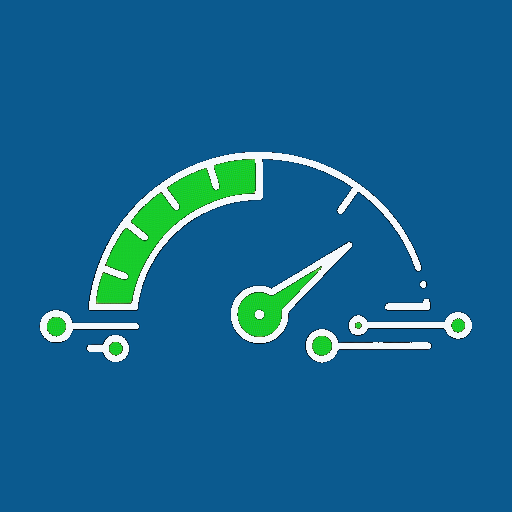
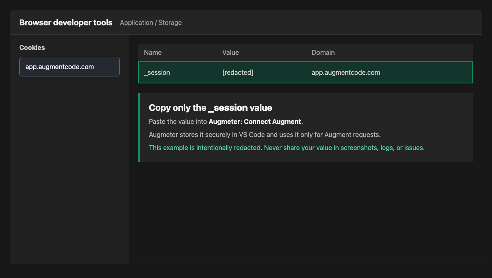

<p align="center">
  
</p>

# Augmeter: Assistant Usage for VS Code

[](https://marketplace.visualstudio.com/items?itemName=kamacode.augmeter)
[](https://marketplace.visualstudio.com/items?itemName=kamacode.augmeter)
[](#data-sources-and-privacy)
[](LICENSE)

See local coding-assistant activity alongside usage reported by connected providers.

Augmeter reads local Claude Code and Codex activity, and can read GitHub Copilot usage from GitHub. Augment credit tracking is a legacy option that is off by default.

| Assistant            | What Augmeter shows                                                                      | Source                              |
| -------------------- | ---------------------------------------------------------------------------------------- | ----------------------------------- |
| **Claude Code**      | Prompts you sent, as local user turns for 5-hour and 7-day windows                       | `~/.claude/projects` logs           |
| **Codex**            | Turns you started, from `task_started` records, for 5-hour and 7-day windows             | `~/.codex/sessions` logs            |
| **GitHub Copilot**   | AI Credits used this month, or legacy premium requests, when the GitHub API is turned on | The GitHub billing API              |
| **Augment** (legacy) | Credit balance and, when available, cycle usage, renewal, and pace                       | Auggie CLI or secure session cookie |

Local activity counts are approximate signals, not provider quotas. Claude Code and Codex activity stays on this machine. Augmeter contacts GitHub only when Copilot API tracking is turned on, and contacts Augment only when Augment credit tracking is turned on.

Claude Code counts leave out tool results, metadata, subagent sessions, background task notifications, local slash commands such as `/model` or `/clear`, bash mode, interrupt markers, and compaction summaries. Codex counts leave out subagent sessions and turns Codex starts on its own, such as scheduled heartbeats, retries, resumed tasks, and reviewer turns.

> Augmeter is independent and open source. It is not affiliated with or endorsed by Augment, Anthropic, OpenAI, GitHub, or Microsoft. Product names are trademarks of their respective owners.


This screenshot shows the dashboard with illustrative values and Augment credit tracking (legacy) off, the default. It contains no local history, provider account data, or credentials.

See [Understanding assistant usage data](docs/usage-data.md) for the exact source and limitations of every number.

## Install

[Install Augmeter from the VS Code Marketplace](https://marketplace.visualstudio.com/items?itemName=kamacode.augmeter), or search for **Augmeter** in the VS Code Extensions view.

## Getting started

### Assistant activity

Local Claude Code and Codex tracking starts automatically when the workspace is trusted. No account sign-in is required.

- Use `augmeter.providers.enabledIds` to choose assistants.
- GitHub Copilot needs the GitHub API. See [GitHub Copilot usage](#github-copilot-usage).
- Local file reading is off in untrusted workspaces.

### GitHub Copilot usage

VS Code no longer records local Copilot request counts, so Augmeter reads Copilot usage from GitHub's billing API. Until you set it up, the Copilot card says so.

1. Create a GitHub token that can read your billing usage. For a fine-grained personal access token, grant the **Plan** user permission (read). See GitHub's [Billing usage](https://docs.github.com/en/rest/billing/usage) reference for the token types each endpoint accepts.
2. Set the token as the `GITHUB_TOKEN` environment variable where VS Code starts, so the extension host can see it. Restart VS Code after you set it.
3. Set `augmeter.providers.copilot.api.username` to your GitHub username.
4. Turn on `augmeter.providers.copilot.api.enabled`.

Augmeter shows the AI Credits you used this month. If your plan still bills premium requests, it shows premium requests instead. GitHub reports consumption only, so Augmeter shows no allowance, percentage, or reset date.

This API covers Copilot plans billed to you. If an organization or enterprise pays for your Copilot, GitHub may return no personal billing data, and the card says so.

### Augment credits (legacy)

Augment changed its billing to dollar-based usage, so credit data may be incomplete or stop updating. Augment credit tracking is now a legacy option:

- It is off by default. While it is off, Augmeter runs no Auggie CLI command, makes no Augment request, and shows no Augment information or commands.
- If you already used Augment in Augmeter (stored credit data or a saved session cookie), Augmeter turns `augmeter.augment.enabled` on for you once. It never overrides a value you set yourself.
- To turn it on, set `augmeter.augment.enabled` to `true`.

When it is on, open **Augmeter: Open Assistant Usage** or click the disconnected status-bar item, then choose **Connect Augment**. **Augmeter: Connect Augment (Legacy)** remains available in the Command Palette.

If Auggie CLI is installed and already connected, Augmeter reads `auggie account status`. No additional Augment sign-in is required, and Augmeter never reads CLI credentials.

Current Auggie CLI output reports a remaining balance and monthly allowance, but not exact cycle consumption. Augmeter labels that data as balance-only and does not infer `0 used`, a percentage, pace, or trends. Exact cycle metrics appear only when the connected source supplies them.

```sh
npm install -g @augmentcode/auggie
auggie login
```

If VS Code cannot find an installed CLI, set `augmeter.auggieCli.path` to its full path.

#### Session-cookie fallback

When Auggie CLI is unavailable, Augmeter can use your Augment `_session` cookie:

1. Run **Augmeter: Connect Augment (Legacy)**.
2. Sign in at [app.augmentcode.com](https://app.augmentcode.com).
3. In browser developer tools, open Application or Storage, then Cookies.
4. Copy the value of `_session`.
5. Paste it into Augmeter if clipboard detection has not already completed the connection.



This example is fully redacted. Copy only the cookie value.

The cookie is stored in VS Code's secure storage and used only for Augment requests. Augmeter watches the clipboard only during the connection step. Choose `auto`, `auggie-cli`, or `cookie` with `augmeter.dataSource`.

Treat `_session` as a credential: never paste it into an issue, log, screenshot, or exported diagnostic. If it is exposed, sign out of Augment to invalidate the session before connecting again.

## Usage

The status bar tooltip and the Assistant Usage view put assistant activity first. Augment values appear only when Augment credit tracking (legacy) is on.

| State                    | Status bar                | Next action                          |
| ------------------------ | ------------------------- | ------------------------------------ |
| Augment off (default)    | `Augmeter`                | Click to open Assistant Usage        |
| Augment on, disconnected | `Augmeter`                | Click to open Assistant Usage        |
| Loading                  | `Augmeter` with a spinner | Wait or click later to refresh       |
| Augment on, connected    | Labeled Augment values    | Click to refresh, open, or configure |

The dashboard provides **Refresh**, **Settings**, and **Connect Augment** actions. **Exports and support** contains CSV/JSON exports, copy actions, and disconnect. Updates preserve keyboard focus, scroll position, and expanded details. Unavailable sources keep their last recorded values with a visible status; paused collection is labeled explicitly.

Local activity is cached for up to five minutes during background polling. **Refresh** bypasses this cache, and overlapping refreshes share one collection.

### Commands

- **Augmeter: Refresh Assistant Usage** updates every enabled source.
- **Augmeter: Open Assistant Usage** opens assistant activity and usage reported by connected providers.
- **Augmeter: Export All Usage Data (JSON)** exports assistant activity, Augment credits when present, health states, and relevant settings.
- **Augmeter: Copy Diagnostics** copies support information with configured paths and GitHub usernames redacted. It excludes raw provider messages and details; review usage figures before sharing.
- **Augmeter: Open Settings** opens all Augmeter settings.

These commands appear in the Command Palette only when Augment credit tracking (legacy) is on:

- **Augmeter: Connect Augment (Legacy)** reads credits through Auggie CLI or a session cookie.
- **Augmeter: Disconnect Augment (Legacy)** removes Augmeter's connection. It does not sign out Auggie CLI. It also appears while the option is off if a session cookie is still stored, so you can remove it without sending a request.
- **Augmeter: Copy Augment Credit Summary (Legacy)** copies the current Augment balance and pace.
- **Augmeter: Export Augment Credit History (CSV) (Legacy)** exports local Augment snapshots.

## Configuration

All settings live under `augmeter.*` in VS Code Settings. These are the most common controls:

| Setting                          | Default                      | What it controls                                            |
| -------------------------------- | ---------------------------- | ----------------------------------------------------------- |
| `enabled`                        | `true`                       | All Augmeter collection and display                         |
| `refreshInterval`                | `60` seconds                 | Refresh interval while VS Code is focused                   |
| `clickAction`                    | `refresh`                    | Status-bar click behavior                                   |
| `providers.enabled`              | `true`                       | Assistant activity tracking                                 |
| `providers.enabledIds`           | `claude`, `codex`, `copilot` | Assistants included in tracking                             |
| `providers.copilot.api.enabled`  | `false`                      | Copilot AI Credits (or legacy premium requests) from GitHub |
| `providers.copilot.api.username` | empty                        | GitHub account whose Copilot usage Augmeter reads           |
| `augment.enabled`                | `false`                      | Augment credit tracking (legacy)                            |
| `budget.cycleTarget`             | `0`                          | Personal target for the current Augment billing cycle       |
| `history.retentionDays`          | `35`                         | Local credit history kept for trends and CSV export         |

When Augment credit tracking (legacy) is on and connected, the status bar shows current Augment cycle usage, credits left, and native VS Code warning colors. Otherwise it shows `Augmeter`. The tooltip and Assistant Usage view provide the detailed breakdown.

## Data sources and privacy

- Claude Code and Codex turn counts come from local session logs and never leave this machine.
- Copilot usage comes from GitHub's billing API, only when you turn it on. Augmeter reads `GITHUB_TOKEN` from the extension host environment and sends it only to GitHub. It does not store or log the token.
- Augment credit requests use Auggie CLI or the Augment API, only when Augment credit tracking (legacy) is on.
- Session cookies are stored in VS Code's secure storage and redacted from logs.
- Credit history, assistant activity, and diagnostics remain local unless you export or paste them.
- Augmeter does not send extension analytics or telemetry events.
- Local file reading and the Copilot API request are off in untrusted workspaces.

For counting rules, freshness semantics, and a source-by-source explanation of the dashboard, see [Understanding assistant usage data](docs/usage-data.md).

Augmeter ships with zero runtime package dependencies. It can invoke an existing `auggie` binary, only when Augment credit tracking (legacy) is on. See [SECURITY.md](SECURITY.md) for the subprocess, secret, and Workspace Trust model.

## Requirements

- VS Code `>= 1.104.0`
- Node.js `>= 20.18.0` for development only

## Troubleshooting

- **No Augment information or commands:** Augment credit tracking (legacy) is off. Set `augmeter.augment.enabled` to `true` if you still want it.
- **Augment credits not connected:** Run **Augmeter: Connect Augment (Legacy)**. If a saved cookie expired, copy a fresh `_session` value.
- **Augment credits keep loading:** Run **Augmeter: Refresh Assistant Usage**, then check your network and Output > Augmeter.
- **No Claude Code or Codex activity:** Confirm the configured path contains session logs and the workspace is trusted.
- **Claude Code or Codex numbers changed after an update:** Augmeter now counts only turns you started. See [Understanding assistant usage data](docs/usage-data.md).
- **Copilot says the GitHub API is not set up:** Follow [GitHub Copilot usage](#github-copilot-usage).
- **Copilot can't find `GITHUB_TOKEN`:** Set the variable before VS Code starts, then restart VS Code. A variable set only in an integrated terminal is not visible to the extension host.
- **Copilot says GitHub returned no personal billing data:** The billing API covers Copilot plans billed to you. Organization-managed Copilot seats may return nothing.
- **Copilot says GitHub denied access (HTTP 403):** Check that `GITHUB_TOKEN` can read your billing usage. A fine-grained personal access token needs the **Plan** user permission (read).
- **No status-bar item:** Check `augmeter.enabled` and `augmeter.showInStatusBar`, then review Output > Augmeter.

## Contributing

1. Fork and clone the repo
2. `npm install`
3. Development:
   - Run and Debug > "Run Extension" (uses `npm run watch`)
   - Tests: `npm run test:all` (unit + integration) or `npm run test:unit`
   - Lint/format: `npm run lint` / `npm run format`
4. Package: `npm run package` (produces a `.vsix`)

### Testing conventions

- **Unit tests** live in `src/unit/` as `*.unit.test.ts`, run by Vitest in a Node environment with the VS Code API mocked (`test-setup/vitest-setup.ts`).
- **Integration tests** live in `src/test/suite/` as `*.test.ts`, run in a real extension host via `@vscode/test-cli` (configured in `.vscode-test.mjs`, compiled with `tsconfig.test.json`).

Please follow conventional commit messages and keep changes focused. Open an issue first to discuss substantial changes.

## Releasing

Releases are automated via GitHub Actions. Pushing a `vX.Y.Z` tag triggers the workflow, which lints, tests, packages a `.vsix`, creates a GitHub Release, and (if `VSCE_PAT` is configured) publishes to the VS Code Marketplace.

### Steps

1. **Bump version** (do not create a git tag yet):
   ```sh
   npm version patch --no-git-tag-version
   # or: npm version minor --no-git-tag-version
   ```
2. **Update `CHANGELOG.md`** with the new version and changes.
3. **Commit and tag**:
   ```sh
   git add package.json package-lock.json CHANGELOG.md
   git commit -m "Release vX.Y.Z"
   git tag vX.Y.Z
   git push origin main --tags
   ```
4. The release workflow handles the rest.

### What happens automatically

- Linting and tests run
- Tag is verified against `package.json` version
- `.vsix` artifact is built and uploaded
- GitHub Release is created with the `.vsix` attached
- If `VSCE_PAT` secret is set, the extension is published to the VS Code Marketplace

### Troubleshooting

| Problem                              | Fix                                                                                                                              |
| ------------------------------------ | -------------------------------------------------------------------------------------------------------------------------------- |
| **Tag/version mismatch**             | `package.json` version must match the tag (e.g. tag `v1.2.3` requires version `1.2.3`). Delete the tag, fix the version, re-tag. |
| **Expired PAT**                      | Rotate the Azure DevOps PAT, update the `VSCE_PAT` secret in GitHub, and re-run the workflow.                                    |
| **Duplicate version on Marketplace** | The publish step uses `--skip-duplicate` and will succeed without re-publishing. Bump the version for new changes.               |

### Manual fallback

If the automated publish fails, download the `.vsix` from the GitHub Release and upload it manually at https://marketplace.visualstudio.com/manage/publishers/kamacode.

## License

MIT. See [LICENSE](LICENSE).

## Changelog

See [GitHub Releases](https://github.com/markomiric/augmeter/releases).
