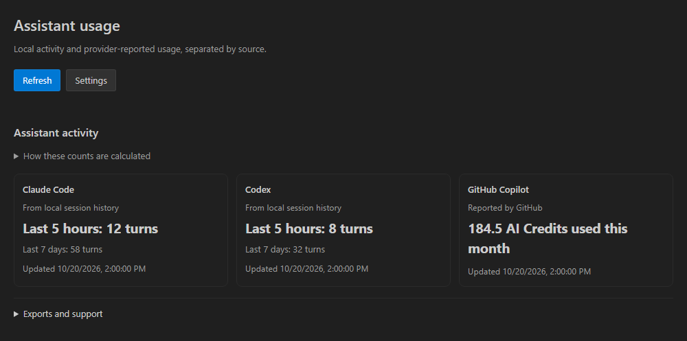

# Understanding assistant usage data

Augmeter combines local coding-assistant activity with usage reported by connected providers. The cards use different labels because the sources measure different things.

_Rendered from an earlier version of the dashboard with illustrative values. It still shows Augment credits without the legacy label, and Copilot premium requests instead of AI Credits. No local history, account data, or credentials are shown._

## Reading the dashboard

- **From local session history** means Augmeter counted local Claude Code or Codex turns that you started.
- **Reported by GitHub** means GitHub supplied Copilot AI Credits, or legacy premium requests, for the current month.
- **GitHub billing API** with a message instead of a number means Copilot has no data yet. The message says why: the GitHub API is not turned on, the username or `GITHUB_TOKEN` is missing, GitHub denied the token access to billing data, or GitHub returned no personal billing data.
- **Augment credits (legacy)** sections appear only when `augmeter.augment.enabled` is on. **Official balance and cycle data from Augment** appears only when the connected source supplies those values.

Claude Code and Codex counts are approximate signals built from undocumented local log formats. They are not provider quotas, and a future log format change can shift them.

Use **Refresh** to collect the latest enabled sources, **Settings** to choose sources, and **Exports and support** for occasional actions. If a refresh fails, the source status appears beside any retained values. Missing data is never treated as zero usage or an invented quota.

## What each number means

| Card             | Value                                                        | Source                                                      | Important limitations                                                                                                                                                      |
| ---------------- | ------------------------------------------------------------ | ----------------------------------------------------------- | -------------------------------------------------------------------------------------------------------------------------------------------------------------------------- |
| Claude Code      | Turns you started, in rolling 5-hour and 7-day windows       | JSONL files under `~/.claude/projects`                      | See [Claude Code counting rules](#claude-code-counting-rules). This is an activity signal, not an Anthropic quota.                                                         |
| Codex            | Turns you started, in rolling 5-hour and 7-day windows       | JSONL files under `~/.codex/sessions`                       | See [Codex counting rules](#codex-counting-rules). This is an activity signal, not an OpenAI quota.                                                                        |
| GitHub Copilot   | AI Credits used this month, or legacy premium requests       | The GitHub billing API, when turned on                      | Consumption only. GitHub reports no allowance, so Augmeter shows no limit, percentage, or reset date. Requires `GITHUB_TOKEN` and covers only Copilot plans billed to you. |
| Augment (legacy) | Remaining credits, monthly allowance, plan, and renewal date | `auggie account status`, or the Augment API when configured | Off unless `augmeter.augment.enabled` is on. Augment changed its billing to dollar-based usage, so credit data may be incomplete or stop updating.                         |

## Claude Code counting rules

Claude Code writes many lines with `type: "user"` that you did not type. A line counts only when all of these hold:

1. It is not marked as metadata (`isMeta`), a compaction summary (`isCompactSummary`), or transcript-only (`isVisibleInTranscriptOnly`).
2. If it has an `origin.kind`, the kind is `human`.
3. If it has a `turnOrigin`, the value is `human` or `sdk`.
4. It has text or image content.
5. Its text does not start with a marker Claude Code writes itself: `<task-notification>`, `<local-command-stdout>`, `<local-command-stderr>`, `<command-name>`, `<bash-input>`, `<bash-stdout>`, `<bash-stderr>`, or `[Request interrupted by user`.

What this means in practice:

- Counted: prompts you type, prompt-type slash commands such as skills (their lines start with `<command-message>`), and prompts sent through headless `claude -p`, the Agent SDK, or Claude Desktop (`turnOrigin: "sdk"`).
- Not counted: tool results, background task notifications, messages from other agents (`turnOrigin: "peer"`), local built-in commands such as `/model`, `/clear`, or `/compact` and their output, bash mode, interrupt markers, compaction summaries, and anything under a `subagents` directory.

## Codex counting rules

Augmeter skips sessions whose first line marks them as subagent sessions, and skips files not modified in the last 7 days.

Current Codex versions write an `event_msg` record with a `task_started` payload for each turn. A `task_started` record counts when:

- it has no `turn_attribution`, as in older Codex versions, or
- its `turn_attribution` has no `parent_turn_id` (a root turn), and its `turn_trigger` is not one of `automation_heartbeat_scheduled`, `capacity_retry_automatic`, `guardian_review`, `resume_interrupted_task`, `retry`, or `goal`.

Unknown or empty triggers count, so new ways to start a turn are not silently dropped. Turns started with `codex exec` count, because a person or their script sent them.

Older Codex history files record turns as `event_msg` records with a `user_message` payload. Some of those files also contain `task_started` records for the same turns. To avoid counting a turn twice, Augmeter decides per file:

- If a file contains any `task_started` record, only `task_started` records count.
- Otherwise, `user_message` records count.

Known limitation: a single file that has older turns with only `user_message` records, followed by newer turns with `task_started` records, counts only the `task_started` turns. The older turns in that file are not counted.

## Why Augment may show more remaining than the monthly allowance

Rollover credits can make the remaining balance larger than the monthly allowance. These are separate values:

- **Remaining credits** is the exact balance reported by Auggie.
- **Monthly allowance** is the plan's regular monthly allocation.
- **Cycle usage** is shown only when the source reports enough information to calculate it reliably.

Augmeter does not infer `0 used` from a balance-only response. It also shows the renewal date without deriving a day countdown because Auggie provides a calendar date, not an exact renewal time.

## Freshness

Each card's **Updated** timestamp is when Augmeter last collected that source. It is not the time the dashboard webview happened to open, and it does not imply that a provider event occurred at that exact moment.

Background collection can reuse local assistant results for up to five minutes. Manual **Refresh** bypasses this cache. A disconnected optional Augment account does not make a successful local refresh fail.

Credit trends are changes between saved readings inside each labeled window, not guaranteed full-window totals. Partial history can cover less than the labeled period. Adjacent weekly snapshots are not compared as if they represented separate weeks.

## Status tooltip

The tooltip uses the same definitions as the dashboard:

- Claude Code and Codex lines are local turns you started.
- The Copilot line reads "N AI Credits used this month" or "N premium requests this month". Without data, it shows the same setup or error message as the dashboard.
- Augment lines appear only when `augmeter.augment.enabled` is on, under the heading **Augment credits (legacy)**. Balance-only Augment data never produces an invented percentage or pace.

When Augment credit tracking (legacy) is off, the status bar shows `Augmeter` and the tooltip lists assistant activity only.

## Verification paths

The production counting logic lives in:

- [`claude-provider-adapter.ts`](../src/providers/adapters/claude-provider-adapter.ts)
- [`codex-provider-adapter.ts`](../src/providers/adapters/codex-provider-adapter.ts)
- [`copilot-provider-adapter.ts`](../src/providers/adapters/copilot-provider-adapter.ts)
- [`auggie-cli-source.ts`](../src/services/auggie-cli-source.ts)
- [`usage-dashboard.ts`](../src/ui/usage-dashboard.ts)

Regression coverage for these semantics lives in the corresponding files under [`src/unit`](../src/unit).
